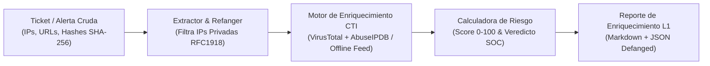

# 🕵️‍♂️ SOC L1 Threat Intelligence & IOC Triage Automator (Mini-SOAR)


Herramienta de automatización de respuesta y enriquecimiento de **Indicadores de Compromiso (IOCs)** diseñada para acelerar el triaje de un **Analista SOC Nivel 1 (Tier 1)** reduciendo el **MTTR** (*Mean Time To Respond*).

---

## 🎯 ¿Qué problema resuelve en un SOC Nivel 1?

Cuando el SIEM genera una alerta (como las de nuestro [Proyecto 1: Mini-SIEM](https://github.com/GabrielMartinez97/soc-l1-log-analyzer-siem)), el analista SOC L1 recibe un ticket lleno de direcciones IP, dominios, URLs y hashes de archivos (`SHA-256`).

Investigar manualmente cada indicador abriendo pestañas en **VirusTotal**, **AbuseIPDB** y **URLhaus** toma entre 15 y 20 minutos por ticket. Este **Mini-SOAR** automatiza todo el flujo en segundos:

1. **Extracción y Refanging:** Extrae automáticamente IPs, dominios, URLs y hashes `SHA-256` desde texto crudo (incluso si están *defanged* como `185.220.101[.]45`).
2. **Filtrado de IPs Privadas (RFC 1918):** Descarta automáticamente IPs internas de la empresa (`10.x.x.x`, `192.168.x.x`, `172.16-31.x.x`) para no enviarlas a APIs públicas ni perder tiempo investigando IPs locales en OSINT.
3. **Enriquecimiento Threat Intelligence (OSINT):** Consulta **AbuseIPDB** y **VirusTotal** (con soporte para API Keys reales en `.env` o base de inteligencia CTI local para pruebas offline).
4. **Cálculo de Riesgo y Veredicto SOAR:** Clasifica cada IOC como `MALICIOUS`, `SUSPICIOUS` o `BENIGN` y genera la nota de triaje con los IOCs nuevamente *defanged* lista para pegar en el ticket.

---

## 🏗️ Arquitectura del Flujo SOAR



---

## 📂 Estructura del Proyecto

```text
soc-l1-threat-intel-soar/
├── samples/
│   └── raw_ticket_input.txt    # Ticket SIEM simulado con IPs internas/externas, URLs y hashes
├── src/
│   ├── __init__.py
│   ├── extractor.py            # Extracción regex, Refanging, Defanging y filtro RFC 1918
│   ├── enricher.py             # Clientes API (VirusTotal/AbuseIPDB) + Feed CTI de respaldo
│   └── soar_reporter.py        # Generador de veredicto y plantilla de triaje SOC L1
├── reports/
│   ├── SOAR_Threat_Intel_Report.md # Reporte CTI generado automáticamente
│   └── soar_enrichment.json        # Exportación estructurada para integración SOAR
├── tests/
│   └── test_soar.py                # Pruebas unitarias de RFC1918, refanging y veredictos
├── .env.example                    # Plantilla segura para API Keys
├── main.py                         # CLI principal del Mini-SOAR
└── README.md
```

---

## 🚀 Ejecución Rápida (CLI y Pruebas)

1. **Ejecutar el enriquecimiento automático sobre el ticket de entrada:**
   ```bash
   python main.py
   ```
   **Salida en consola:**
   ```text
   ========================================================================================
     SOC L1 THREAT INTELLIGENCE & IOC TRIAGE AUTOMATOR (MINI-SOAR)
   ========================================================================================
   [+] Activos Internos RFC 1918 descartados de OSINT: ['10.10.20.15', '192.168.1.50']
   [+] IOCs Externos extraídos: 5 IPs | 2 Dominios/URLs | 2 Hashes SHA-256
   ----------------------------------------------------------------------------------------
   VERDICT     | SCORE   | TYPE       | IOC (DEFANGED)                      | INTEL / FAMILY
   ---------------------------------------------------------------------------------------------------------
   MALICIOUS   | 100/100 | SHA-256    | 24d004a104d4d54034dbcffc2a4b19a1... | Familia: Ransomware.WannaCry / Cryptor
   MALICIOUS   | 96/100  | IPv4       | 198.51.100[.]77                     | Offshore VPS Hosting
   MALICIOUS   | 95/100  | IPv4       | 185.220.101[.]45                    | Zwiebelfreunde e.V. (Tor Network)
   MALICIOUS   | 92/100  | URL/Domain | hxxp://c2.attacker-domain[.]xyz/... | C2 Credential Harvester
   MALICIOUS   | 88/100  | URL/Domain | drop.darknet-loader[.]ru            | Malware Dropper Infrastructure
   MALICIOUS   | 85/100  | IPv4       | 45.155.205[.]109                    | Selectel Bulletproof Hosting
   SUSPICIOUS  | 58/100  | IPv4       | 91.240.118[.]222                    | Scanner Cloud ASN
   BENIGN      | 0/100   | IPv4       | 8.8.8[.]8                           | Google LLC (Google Public DNS)
   BENIGN      | 0/100   | SHA-256    | e3b0c44298fc1c149afbf4c8996fb924... | Microsoft Windows Genuine File (Empty/Clean Hash)
   ```

2. **Ejecutar las pruebas unitarias:**
   ```bash
   python -m unittest discover -s tests -v
   ```

3. **Ver el reporte de triaje CTI generado:**
   * 📄 [Ver Reporte SOAR de Threat Intelligence](reports/SOAR_Threat_Intel_Report.md)

---

## 👤 Autor

* **Gabriel Martínez** ([@GabrielMartinez97](https://github.com/GabrielMartinez97)) — *Cybersecurity SOC L1 Portfolio*
